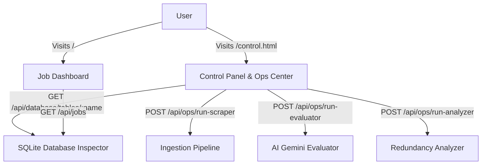

# Control Panel & Dual-View Architecture Plan

## Overview

We are expanding Lokisjobb into a dual-view application:

1. **Job Dashboard (`/index.html`)**: Focused on job tracking, filtering, AI scores, and managing applications.
2. **Control Panel (`/control.html`)**: An operations center to trigger pipeline jobs (scraper, AI evaluator, redundancy analyzer) and inspect SQLite database tables (`jobs`, `job_sources`) with raw JSON/table inspection and execution logs.

---

## 1. Backend API Endpoints (`src/server.ts`)

- `GET /api/database/stats`: Returns database table counts, total records, last updated timestamps, and source breakdown.
- `GET /api/database/tables/:tableName`: Returns raw rows for `jobs` or `job_sources`.
- `POST /api/ops/run-scraper`: Triggers job ingestion across all sources and queries, streaming or returning execution logs and summary stats.
- `POST /api/ops/run-evaluator`: Triggers AI evaluation for unevaluated jobs.
- `POST /api/ops/run-analyzer`: Triggers source redundancy analysis and returns the report.

---

## 2. Frontend Layout & Navigation

- **Top Navigation Bar**: Present on both pages (`Dashboard` vs `Control Panel`) with dark mode / tech styling.
- **Control Panel (`public/control.html` & `public/control.js`)**:
    - **Action Runner Grid**: Cards for Scraper, AI Evaluator, and Redundancy Analyzer with "Run" buttons and loading spinners.
    - **Terminal / Console Log Box**: Real-time output display showing stdout/stderr or execution results from the triggered operations.
    - **Database Inspector**: Tabular view and JSON raw inspector for SQLite tables (`jobs` and `job_sources`) with search and pagination/filtering.

---

## 3. Mermaid Workflow Diagram

