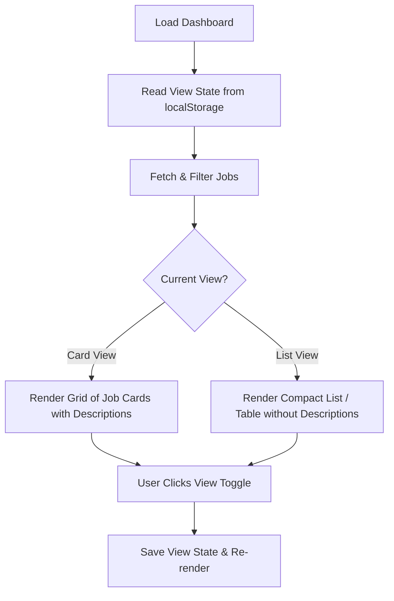

# Dashboard List View Implementation Plan

## Overview

Add a toggleable compact list view to the job dashboard alongside the existing card view, skipping descriptions and presenting key job details in a compact format.

## Architecture & Changes

### 1. HTML (`public/index.html`)

- Add a View Toggle component (Card View vs List View icons/buttons) in the filters/sorting toolbar.
- Container `#output` will dynamically switch between grid layout (`grid grid-cols-1 md:grid-cols-2 lg:grid-cols-3 gap-6`) for cards and stack/table layout for list view.

### 2. JavaScript (`public/index.js`)

- Maintain `currentView` state (defaulting to `'card'`, saved/loaded from `localStorage`).
- Add event listeners for view toggle buttons.
- In `updateDashboard()`, branch rendering based on `currentView`:
    - **Card View:** Existing grid of rich cards with descriptions.
    - **List View:** Compact rows / table showing Status, Availability, AI Score, Title + Company + Location, Sources, Discovered/Deadline, and View Job link. Skips description entirely for high density.

## Mermaid Workflow

