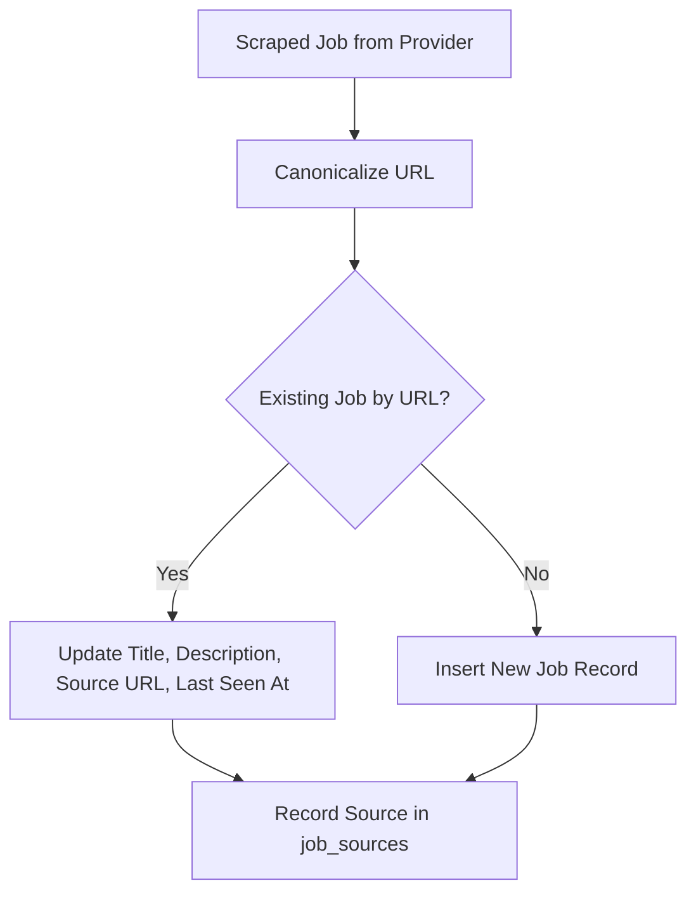

# Plan: Automatically Merge Jobs with Same URL and Different Titles

## Overview

When multiple job providers index the same vacancy (identified by a canonical URL), they may report slightly different titles. Currently, [`src/database/jobs.ts`](src/database/jobs.ts:86) preserves the original title upon re-ingestion and does not update it. The goal is to ensure that jobs pointing to the same URL automatically merge and update their title (or incorporate multi-source updates) so that title variations across providers are correctly handled and merged into the canonical job record.

## Architecture & Workflow

## Actionable Steps

1. Update [`src/database/jobs.ts`](src/database/jobs.ts:86) `upsert` method to update `title` when an existing job is found by URL (`canonicalJob` or `sourceJob`).
2. Update tests in [`src/database/jobs.test.ts`](src/database/jobs.test.ts:62) to assert that re-ingesting a job with a different title updates the title while preserving local decisions (status, aiScore, discoveredAt).
3. Verify all database and integration tests pass.
