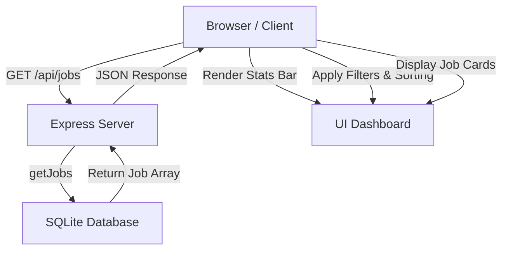

# Website Rework Plan - Lokisjobb

## Architecture & Overview

The goal is to transform the basic HTML page into a modern, responsive job tracker dashboard.

### 1. Stats Bar (Top)

Calculated from the loaded jobs dataset:

- **Total Jobs**: Count of all stored jobs.
- **Active Jobs**: Count of jobs with availability === 'active'.
- **Interested**: Count of jobs where status === 'interested'.
- **Applied**: Count of jobs where status === 'applied'.
- **Avg AI Score**: Average `aiScore` across scored jobs.

### 2. Filters & Search

- **Search Query**: Text input searching across title, company, and location (case-insensitive).
- **Status Filter**: All, New, Interested, Applied, Rejected.
- **Availability Filter**: All, Active, Closed, Unknown.
- **Source Filter**: All sources (extracted from job sources records).
- **AI Score Filter**: Min score slider or dropdown.

### 3. Sorting

- Discovered Date (Newest / Oldest)
- AI Score (Highest / Lowest)
- Title (A-Z / Z-A)
- Company (A-Z / Z-A)
- Deadline (Nearest / Farthest)

### 4. Job List / Cards UI

- Clean card-based or table-based layout with badges for status, AI score, sources, availability, and direct links to job postings.
- Ability to update job status or view full description in a modal / expander.

## Workflow / Data Flow

## Action Plan

1. Update `public/index.html` with a modern Tailwind-based (via CDN) or CSS grid dashboard layout, incorporating the stats header, filter/sort controls toolbar, and job cards grid.
2. Update `public/index.js` to manage state (jobs data, active filters, search query, sorting criteria), calculate stats, render UI components dynamically, and handle interactivity.
3. Verify server API integration and test responsiveness.
